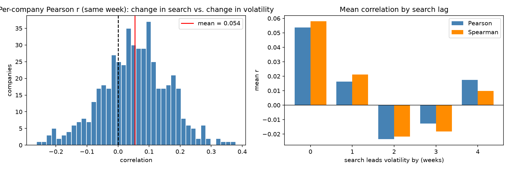

# Can Google Trends Data Predict Stock Volatility?



> Keywords: Google Trends, Stock Volatility, Yahoo Finance, TF-IDF, Pearson, Spearman, Lag, Predictability, S&P500, Finance, Search Data

## Group Members
- Ike Mittman
- Dyanne Jiang

## Introduction
The stock market has already been proven to be affected by decisions of people and organizations of power around the world, including governments, presidents, military leaders, and the United Nations. However, the impact of the sheer volume of the general public on the stock market has yet to be fully observed. This study investigates the impacts of the Google search volume on stock volatility by comparing the changes in the weekly search volume of the top four relevant TF-IDF words for each S&P500 company against the fluctuations in the price of their stock shares. Ultimately, the research question of this question surrounds: Do weekly changes in Google search interest for company-specific terms track, or lead, weekly changes in stock volatility in the market for S&P500 companies?

## Methods
- Web scraping
- TF-IDF matrix
- Google search volume analysis
- Company stock shares price analysis
- Correlations

## Hypothesis
Our hypothesis predicts that the Google search volume of the top four TF-IDF words is a tell of fluctuation in the stock market within the next two weeks with a correlation greater than |0.5|.

## GitHub Repository
```
├── README.md
├── .gitignore
├── notebooks/
│   ├── finalproject_part1.ipynb
│   └── finalproject_part2.ipynb
├── data/                               # raw data
│   ├── googletrends/                   # google search volume of top 4 tf-idf words for each company
│   ├── company_names.csv               # all s&p500 company names in .csv form
│   ├── company_names.json              # all s&p500 company names in .json form
│   └── s&p500list.html                 # scraped s&p500 wikipedia page
├── outputs/                            # analysis data
│   ├── plots/                          # price and volatility plots for each company
│   ├── corr_by_lag.pdf                 # pearson and spearman correlation of each lag of a certain company
│   ├── corr_figure.png                 # pearson correlation and mean correlation of each lag of a certain company
│   ├── correlation.csv                 # directional agreement, pearson, and spearman correlation of all companies
│   ├── cross_section_summary.csv       # correlation analysis of a company
│   ├── example_company.pdf             # search interest, price, and volatility plot of a certain company
│   ├── histograms.pdf                  # stock volatility and search interest summary analysis of a certain company
│   ├── lag.csv                         # maximum correlation of the highest correlated lag of all companies
│   ├── per_conpany_results.csv         # pearson correlation and spearman correlation lag analysis of all companies
│   ├── pooled_regression.csv           # search lag pooled regression analysis of a certain company
│   ├── search_lag_data.csv             # search lag analysis of a certain company
│   ├── sectors.csv                     # correlation analysis of each sector
│   ├── summary_by_lag.csv              # correlation analysis of a company, with standard deviations
│   ├── volatility_correlations.csv     # volatility correlation of all companies
│   ├── volatility_lag.csv              # volatility of lags of all companies
│   └── volatility_sectors.csv          # volatility correlation of each sector
└── final_report.pdf                    # final PDF/LaTeX research paper
```

## Summary of Findings
Though our study, we discovered that changes in search interest are weakly and positively correlated with same-week changes in realized volatility (mean r ≈ 0.05; 70% of companies positive; ~11–12% significant at 5% vs ~5% expected by chance). The most predictive lag sits at 0.48 weeks in advance with the highest correlation of 0.211. The sector of Consumer Discretionary had the highest directional agreement of 0.512, and the sector of Consumer Staples had the highest predictive correlation of 0.213. Lagged search changes (1–4 weeks) show no consistent lead. See `final_report.pdf` for the full research paper.

## Future Work
Directions for future work in the same research include formally testing the average effect while controlling for common weekly shocks (week fixed effects, clustering by week as well as company, or demeaning each variable across companies each week) and applying a multiple-testing correction to the per-company results, excluding earnings and holiday weeks, searching for the company name or ticker instead of industry terms, since the TF-IDF terms may reflect interest in an industry more than in the company, using a longer window or daily data, and testing search against price returns (the direction of price change), not only volatility.

## Related Work
Askitas, Nikolaos, and Klaus F. Zimmermann. 2009. “Google Econometrics and Unemployment Forecasting.” *Applied Economics Quarterly* 55(2): 107–120

Barber, Brad M., and Terrance Odean. 2008. “All That Glitters: The Effect of Attention and News on the Buying Behavior of Individual and Institutional Investors.” *The Review of Financial Studies* 21(2): 785–818

Guzmán, Giselle. 2011. “Internet Search Behavior as an Economic Forecasting Tool: The Case of Inflation Expectations.” *Journal of Economic and Social Measurement* 36(3): 119–167

Lazer, David, Ryan Kennedy, Gary King, and Alessandro Vespignani. 2014. “The Parable of Google Flu: Traps in Big Data Analysis.” *Science* 343(6176): 1203–1205

## Data Sources
- [S&P 500 constituents (Wikipedia)](https://en.wikipedia.org/wiki/List_of_S%26P_500_companies)
- [SEC EDGAR](https://www.sec.gov/edgar) (10-K filings)
- [Google Trends](https://trends.google.com) via `pytrends` (weekly, US, Nov 1 2024 – Nov 1 2026)
- [Yahoo! Finance](https://finance.yahoo.com) via `yfinance` (daily adjusted closes)

